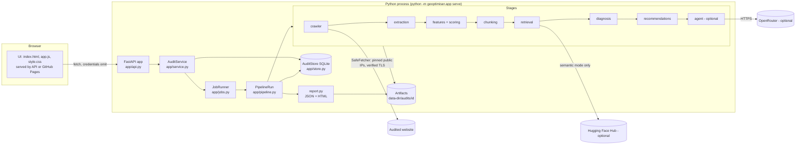

# Architecture

This is the architecture **as implemented** on branch `claude/geoptimiser-final-master`.
Planned components are labelled as planned. For the order in which code runs, see
[EXECUTION_FLOW.md](EXECUTION_FLOW.md); for why things are the way they are, see
[PROJECT_DECISIONS_AND_HISTORY.md](PROJECT_DECISIONS_AND_HISTORY.md).

## 1. System overview

Geoptimiser audits a website for **GEO (generative engine optimisation) readiness**: how well
its pages can be crawled, read, extracted, retrieved and cited by search and AI answer
systems. A user who owns (or is authorized to test) a site submits a URL. The server crawls
that site with an SSRF-safe crawler, extracts each page's HTML, runs a fixed catalog of 120
features (82 of which have a working check), scores only what it could measure, turns
failures into evidence-linked findings, writes rule-based recommendations, optionally runs a
bounded LLM agent, and produces a JSON and HTML report. A later audit of the same URL can be
compared with an earlier one.

It is a **local-first, single-operator tool**: there is no login, no user model and no
tenant isolation. It is meant to run on the operator's machine, on loopback.

What it does **not** do: execute JavaScript (it reads the HTML the server returns), observe
real AI-answer engines (category L features are not implemented), or claim that any change
will produce rankings or citations.

## 2. High-level diagram

## 3. Components

| Component | Responsibility | Location | Public interface | Inputs → outputs | Depends on | Errors | Data owned | Tests |
|---|---|---|---|---|---|---|---|---|
| Shared schemas | Strict, versioned Pydantic records shared by all stages | `src/geoptimiser/schemas.py` | `FetchRecord`, `PageDocument`, `FeatureResult`, `EvidenceRef`, `Finding`, `Recommendation`, `Chunk`, `AuditRequest` | — | pydantic | validation errors | none | `tests/test_schemas.py`, `tests/test_immutability.py` |
| Crawler | Bounded, robots-aware, SSRF-safe crawl of one domain | `crawler/` (`crawl.py`, `fetcher.py`, `netguard.py`, `robots.py`, `urls.py`, `storage.py`, `config.py`) | `Crawler(...).run()`, `SafeFetcher.fetch` | seed + `CrawlConfig` → `fetches.jsonl`, bodies | stdlib `http.client`, `ssl`, `socket` | every fetch outcome is recorded (`transport_error`, `http_error`, `redirect_not_followed`, …) | raw fetch records, content-addressed bodies | `tests/crawler/` |
| Extraction | Turn stored HTML into `PageDocument`s | `extraction/` | `extract_all`, `parse_html` | fetch records + bodies → `documents.jsonl` | stdlib `html.parser`, `json` | per-page `ExtractionFailure`; deadline, nesting and field caps | extracted documents | `tests/extraction/` |
| Feature engine | Run the 120-feature catalog, apply evidence and contribution policies, score with coverage | `features/` (`catalog_data.py`, `registry.py`, `engine.py`, `checks/`, `evidence.py`, `contribution.py`, `scoring.py`, `findings.py`, `audit.py`) | `run_audit`, `default_registry`, `score_audit` | `AuditInputs` → `AuditRun` (results, evidence, findings, scores) | extraction outputs | a raising check becomes an `error` result; provenance violations raise | feature results, findings, scores | `tests/features/`, `tests/validation/` |
| Chunking | Heading-aware chunks with exact character offsets | `chunking/` | `chunk_documents`, `chunk_document`, `verify_chunks` | documents → `chunks.jsonl` | — | stage failure → audit `incomplete` | chunks | `tests/chunking/` |
| Retrieval | Rank passages for diagnosis and the agent | `retrieval/` | `Retriever`, `build_retriever`, `load_settings` | chunks + query → ranked chunks | BM25 (built in); Sentence Transformers (optional `semantic` extra) | `EmbeddingError` → `retrieval_unavailable` (no silent fallback) | in-memory index | `tests/retrieval/` |
| Diagnosis | Keep feature findings, attach located passages, apply cross-feature rules | `diagnosis/` | `diagnose`, `validate_diagnosis` | `AuditRun` + chunks (+ retriever) → `Diagnosis` | retrieval (optional) | grounding problems reported by `validate_diagnosis` | `findings.json` | `tests/diagnosis/` |
| Recommendations | Template recommendations with claim and URL screening | `recommendations/` | `TemplateGenerator.generate`, `validate_recommendations` | `Diagnosis` → `RecommendationSet` (accepted + rejected) | catalog remediation text | rejected items kept with reasons | `recommendations.json` | `tests/recommendations/` |
| Agent (optional) | Bounded LangGraph loop over six read/validate tools | `agent/` | `run_agent`, `AgentContext`, `ToolRegistry` | audit data → `AgentResult`, `agent_trace.json` | `agent` extra, OpenRouter | `ModelError` → `agent_unavailable`; budgets end runs as `incomplete` | agent trace | `tests/agent/` |
| Application service | Validate submissions, queue jobs, read stored results | `app/service.py`, `app/models.py`, `app/config.py`, `app/jobs.py` | `AuditService` | `AuditSubmission` → `AuditRecord`; ids → stored JSON | store, pipeline | `ServiceError` subclasses with stable codes and HTTP statuses | — | `tests/app/` |
| Pipeline orchestrator | Run the stages in order, record each, decide the outcome | `app/pipeline.py` | `run_pipeline`, `PipelineDeps` | audit id → artifacts + terminal status | all stages | critical vs optional stages (`CRITICAL_STAGES`) | artifacts per audit | `tests/app/test_pipeline.py`, `tests/validation/test_app_pipeline.py` |
| Store | Audit identity, status, stage records, artifact index, comparisons | `app/store.py` | `AuditStore` | — | sqlite3 (WAL) | generic errors; recovery marks unfinished audits `interrupted` | `geoptimiser.db` | `tests/app/test_store_restart.py` |
| Report | Machine-readable report and escaped HTML rendering | `app/report.py` | `build_report`, `render_html`, `AuditReport` | pipeline state → `report.json`, `report.html` | — | rendering happens before writing; failure writes nothing | reports | `tests/app/test_pipeline.py`, `tests/app/test_reportability.py` |
| Comparison | Compare two completed audits of one URL | `app/compare.py` | `compare_reports`, `check_compatible` | two reports → `Comparison` | report | `CompareError` codes (`different_targets`, `audit_not_completed`, `incompatible_versions`, …) | `comparisons/*.json` | `tests/app/test_compare.py` |
| HTTP API | Versioned JSON API and the bundled UI | `app/api.py` | routes under `/api/v1` | HTTP ↔ service | `api` extra (FastAPI, uvicorn) | uniform `{"error": {code, message, request_id}}` | — | `tests/app/test_api.py` |
| UI | Single-page interface | `app/ui/` | hash routes `#/`, `#/audits`, `#/audits/<id>/<tab>`, `#/catalog`, `#/compare` | API JSON → DOM | none (vanilla JS) | errors shown in place | none | `tests/app/test_static_export.py`, `tests/e2e/browser_e2e.py` |
| Static export | Build the UI as a static site for GitHub Pages | `app/static_export.py` | `export_site` | UI files + API base → `site/` | — | invalid API base or domain refused | — | `tests/app/test_static_export.py` |
| Validation harness | Fixtures with pre-declared expectations, matrix, corpus evaluation, overlap analysis | `validation/` | `python -m geoptimiser.validation`, `.matrix`, `.corpus` | fixtures/corpus → metrics, matrix, `feature_levels.json` | the pipeline | — | `docs/validation/*` | `tests/validation/` |
| Visibility, benchmark (not wired into audits) | Provider contract, mock/fixture providers, metrics; query benchmark | `visibility/`, `benchmark/` | library only | — | — | — | — | `tests/visibility/`, `tests/benchmark/` |
| Demo | Reproducible offline before/after demo | `demo/` | `python -m geoptimiser.demo` | bundled demo site → two audits + comparison | pipeline | — | — | `tests/test_demo.py` |

## 4. Frontend architecture

* **Files:** `index.html` (shell, navigation, skip link, live region), `app.js` (all
  behaviour), `style.css` (design tokens and components), two self-hosted OFL fonts
  (`hanken-grotesk.woff2`, `jetbrains-mono.woff2`) and `FONTS-LICENSE.txt`. The backend serves
  exactly these files from a fixed table in `api.py` (`_STATIC`); there is no directory
  serving. `config.js` is generated: empty API base when served by the backend, the deployed
  API origin in the static export.
* **Routing:** hash-based (`parseRoute` in `app.js`): `#/` new audit, `#/audits`,
  `#/audits/<id>/<tab>[/<feature>]` with tabs overview, features, findings, recommendations,
  crawl, retrieval, report, compare; `#/catalog[/<feature>]`; `#/compare`.
* **State:** no framework store. A navigation counter (`generation`) discards responses that
  arrive after the user moved on; terminal reports and per-audit feature results are cached
  because they never change after an audit finishes; the catalog is cached once.
* **Live status:** while an audit is queued or running, the audit page polls
  `GET /api/v1/audits/{id}` with back-off from 1.5 s to 8 s and stops on navigation or a
  terminal status. Stage dots come only from the backend's stage records.
* **API integration:** one `api()` helper: `credentials: "omit"`, a timeout, and uniform error
  objects from the backend's error envelope.
* **Safety:** every value from the API is inserted with `document.createTextNode` through
  `el()`; links built from data are created only for `http(s)` URLs (`safeHref`). Bar widths
  are set through the CSSOM, so the strict CSP (`style-src 'self'`, no inline styles) holds.
* **Scores:** only `reported_score` is shown (`shownScore`); a withheld score shows the
  backend's reason. No score is computed in JavaScript.
* **Design:** light neutral canvas, graphite type, one deep-teal accent, Hanken Grotesk for
  text and JetBrains Mono for identifiers and values. The measurement ledger (the F001–F120
  grid) is the one expressive element.

## 5. Backend architecture

`python -m geoptimiser.app serve` builds an `AppConfig` (data dir, caps, allowed hosts, CORS
origins, agent switch) and an `AuditService`, then serves `create_app(service)` with uvicorn.

* **API (`api.py`):** a guard middleware enforces the `Host` allow-list (DNS-rebinding
  protection), requires a `Content-Length` of at most 16 KiB on POST, and adds security
  headers. Opt-in CORS (exact origins, no credentials). Exception handlers return a uniform
  error envelope and never echo input or stack traces.
* **Service (`service.py`):** submission checks, server caps, queueing; all reads go through
  the audit id → artifact table → data-dir containment check.
* **Models (`models.py`):** `AuditSubmission`, `AuditOptions` (`max_pages` 1–100,
  `max_depth` 0–5, `retrieval` off/lexical/semantic, `use_agent`), `StageRecord`,
  `AuditRecord`, statuses, error categories, `normalize_target`.
* **Jobs (`jobs.py`):** `workers` threads (1–4) and a bounded FIFO queue (`max_queued`).
* **Pipeline (`pipeline.py`):** stage plumbing, outcome rules, report writing.

## 6. Crawling and extraction

1. **Scope:** the submitted domain, its `www.` alias and its subdomains (`urls.host_in_scope`).
2. **Robots:** fetched once per origin; 4xx = allow all, 5xx/transport error = disallow all
   (RFC 9309).
3. **Fetch (`SafeFetcher.fetch`):** URL canonicalised; for each hop the host is resolved once,
   every address must be public (`netguard.is_public_address` plus extra blocked ranges),
   the connection is pinned to that IP, the connected peer is re-checked, TLS verifies the
   hostname. Redirects are followed manually with the same checks; https→http is refused.
   Bodies are streamed and cut at `max_response_bytes`; only `text/html`/XHTML (and
   `text/plain` for robots) bodies are stored; only an allow-list of headers is recorded.
4. **Budgets:** pages, depth, per-response bytes, per-audit bytes and seconds, minimum
   request interval, per-fetch watchdog (`crawler/config.py`).
5. **Storage:** bodies in a content-addressed store (SHA-256, mode 0600), referenced from
   `FetchRecord`s.
6. **Extraction:** `parse_html` (stdlib `HTMLParser`, fed in 64 KiB chunks under a deadline)
   produces title, meta, canonical, headings, visible text, links, JSON-LD (block-count, size
   and nesting limits), images, anchors, landmarks, tables, lists, media, viewport, charset,
   head-completion and render signals. Nothing in the page is executed.

## 7. Feature architecture

* **Catalog (authoritative):** `features/catalog_data.py` defines all 120
  `FeatureDefinition`s (id, category A–L, measurement, method, applicability,
  implementation status, scored or not, base severity, limitations, remediation, overlaps,
  check version). `configs/feature_catalog.json` and `docs/FEATURE_CATALOG.md` are generated
  from it (`python -m geoptimiser.features --export`) and must not be edited by hand.
* **Registry:** `@check("Fxxx", scope=…, requires=…, version=…)` registers a function;
  `default_registry()` refuses a catalog/registry mismatch (an implemented feature without a
  check, a planned one with a check, scope or version drift).
* **Engine:** `run_all` runs every feature: page checks per page, site checks once,
  unimplemented features once as `not_measured`. Outcomes become `FeatureResult`s with
  `EvidenceRef`s; a failure without evidence is impossible (`outcome.failed` requires it).
* **Evidence policy (`evidence.py`):** truncated bodies, extraction limits, interstitial
  pages and incomplete link lists turn results the evidence cannot support into
  `not_measured`.
* **Contribution policy (`contribution.py`):** checks that cannot discriminate under the crawl
  configuration, and units that only repeat another feature, stay visible but out of the
  aggregate.
* **Scoring (`scoring.py`):** pass = 1, fail = 0 (warning partial); `not_applicable`,
  `not_measured` and `error` are excluded from denominators and reported as coverage. A
  group's score is reportable only at or above `min_reportable_coverage`.
* **Shipped validation levels:** `validation/feature_levels.json` (generated with the matrix)
  carries each feature's implementation level, validation level and disposition; the
  `/api/v1/catalog` endpoint serves it with the definitions.

## 8. Retrieval and RAG

* **Ingestion:** the documents of this audit only; chunked by headings with exact offsets
  (`chunk_documents`).
* **Lexical:** BM25 over `[a-z0-9]+` tokens (default).
* **Semantic (optional extra):** `SentenceTransformerEmbedder` (default
  `sentence-transformers/all-MiniLM-L6-v2`), exact cosine scan, hybrid with BM25 through
  reciprocal rank fusion. A hashing embedder exists for tests and is refused by the
  application (`allow_test_embedder=False`).
* **Provenance:** every retrieved passage carries its chunk id, document id, URL and
  character range; diagnosis verifies that the snippet reproduces the source text
  (`diagnosis/grounding.py`).
* **Vector storage:** none persistent — indexes are in memory for one audit. There is no
  vector database, no cross-audit index and therefore no cross-tenant retrieval.
* **Similarity is not evidence:** retrieval only selects passages to attach; findings come
  from deterministic checks.

## 9. Agent

Runs only when the submission asks for it and the server allows it. LangGraph graph
`inspect → decide ↔ act → finalize` (`agent/graph.py`, `agent/runtime.py`) calling an
OpenAI-compatible endpoint (OpenRouter) with the key from `OPENROUTER_API_KEY`. Tools
(`agent/tools.py`): `list_findings`, `get_finding`, `retrieve_passages` (when a retriever
exists), `validate_evidence`, `generate_recommendations`, `validate_output` — all read or
validate in-memory audit data; none touches the shell, files, network or database. Budgets:
iterations, invalid decisions, retries, per-tool timeout, observation size. Website text
reaches the model only inside tool results marked as untrusted. The final status is
recomputed from deterministic checks. The agent's output is written to `agent_trace.json`
only; the report's findings and recommendations come from the deterministic pipeline.

## 10. Scoring and findings

Findings are built only from failing or warning results of their own features
(`build_findings`), carry evidence ids, measurement method, confidence (how sure the
measurement is — not severity), limitations and verification criteria.
Intent-dependent features (for example `noindex`) produce **notices**, not defects, and do
not count toward the score. Diagnosis adds located passages and a small set of scoped
cross-feature rules. Recommendations come from catalog remediation templates; text making
unsupported promises is rejected and listed as held back.

## 11. Data architecture

| Store | What | Where |
|---|---|---|
| SQLite (`geoptimiser.db`, WAL) | audits, stage records, artifact index (relative path, size, SHA-256), comparisons | `<data-dir>/` |
| Files | per-audit artifacts (see EXECUTION_FLOW §4) | `<data-dir>/audits/<audit_id>/` |
| Files | comparisons | `<data-dir>/comparisons/` |
| In memory | retrieval index, agent context | worker, per audit |

Not implemented: a hosted database, a vector database, retention or deletion (data grows
until the operator removes it), encryption at rest, backups.

## 12. API

| Method | Path | Purpose |
|---|---|---|
| GET | `/api/v1/health`, `/api/v1/ready` | liveness; readiness (database, data dir, workers) |
| POST | `/api/v1/audits` | submit (`AuditSubmission`) → 202 `AuditView` |
| GET | `/api/v1/audits?limit=` | list (1–100) |
| GET | `/api/v1/audits/{id}` | one audit with stage records |
| GET | `/api/v1/audits/{id}/report` (`?download=true`) | full JSON report |
| GET | `/api/v1/audits/{id}/report.html` (`?download=true`) | HTML report (CSP `default-src 'none'`) |
| GET | `/api/v1/audits/{id}/findings` | validated findings |
| GET | `/api/v1/audits/{id}/recommendations` | validated recommendations and held-back count |
| GET | `/api/v1/audits/{id}/features` | per-feature results of this audit with score entries |
| GET | `/api/v1/catalog` | catalog definitions, threshold defaults, validation levels |
| POST | `/api/v1/comparisons` | compare two audit ids |
| GET | `/api/v1/comparisons/{id}` | stored comparison |
| GET | `/`, `/ui/app.js`, `/ui/config.js`, `/ui/style.css`, `/ui/hanken-grotesk.woff2`, `/ui/jetbrains-mono.woff2`, `/ui/FONTS-LICENSE.txt` | the fixed UI files; nothing else is served |

The OpenAPI document is at `/api/v1/openapi.json`; interactive docs are disabled.

## 13. Security architecture

Trust boundaries, from the outside in:

1. **Network caller → API.** No authentication. Controls: loopback bind by default (the CLI
   refuses other addresses without `--allow-remote`), `Host` allow-list, body-size cap,
   JSON-only bodies (cross-site simple requests are rejected by validation), opt-in exact
   CORS without credentials, a server-side hourly cap on agent audits
   (`max_agent_audits_per_hour`). Exposure through a tunnel or proxy is a deployment decision
   outside the repository and gives any caller full use of the API.
2. **Caller → crawler egress.** `normalize_target` filters early; `SafeFetcher` enforces the
   public-address policy on every resolved and connected address and every redirect hop.
3. **Website content → host resources.** Byte, time, page and depth budgets; parser
   deadlines and caps.
4. **Website content → model and tools.** Allow-listed tools, schema-validated arguments,
   budgets, deterministic final status; agent output never feeds the report.
5. **Website/model content → browser.** Escaping in the HTML report, text nodes in the UI,
   strict CSPs, `X-Frame-Options: DENY`, `nosniff`, `no-referrer`.
6. **Caller → filesystem.** Strict id formats, artifact-table indirection, data-dir
   containment.

The security audit of this repository (Cloudflare security-audit skill, run 1) and its
remediation are summarised in [SECURITY_REVIEW.md](SECURITY_REVIEW.md).

## 14. Deployment

| Mode | Status | How |
|---|---|---|
| Local backend + bundled UI | implemented | `python -m geoptimiser.app serve` on 127.0.0.1:8000 |
| Static UI on GitHub Pages | workflow prepared (`.github/workflows/pages.yml`); not verified live | `python -m geoptimiser.app.static_export` with the API origin |
| Public backend (for example Cloudflare Tunnel to the local port) | documented only (`docs/DEPLOY_FRONTEND.md`); not configured | requires `--allowed-host` and `--cors-origin`; gives every caller full access because there is no authentication |
| Hosted backend, containers | not implemented | — |

## 15. Technology inventory

| Technology | Purpose | Required? |
|---|---|---|
| Python ≥ 3.11 (CI 3.11–3.14) | everything server-side | yes |
| Pydantic 2 | contracts and validation | yes (only base dependency) |
| stdlib `http.client`, `ssl`, `socket`, `html.parser`, `json`, `sqlite3` | crawler, extraction, store | yes |
| FastAPI, uvicorn | HTTP API and UI serving | `api` extra |
| LangGraph, langchain-openai | optional agent | `agent` extra |
| OpenRouter (OpenAI-compatible API) | optional model provider | only for the agent |
| sentence-transformers (PyTorch), Hugging Face Hub | optional semantic embeddings | `semantic` extra |
| httpx, beautifulsoup4, trafilatura, python-dotenv | declared in the `web` extra; not imported by the audit pipeline | no |
| pytest, pytest-cov, ruff | tests, lint, format | `dev` extra |
| Vanilla JavaScript, CSS, Hanken Grotesk and JetBrains Mono (OFL) | UI | yes (shipped) |
| GitHub Actions, GitHub Pages | CI and static hosting | optional |
| Playwright + Chromium | browser end-to-end check (`tests/e2e/browser_e2e.py`) | development only |
