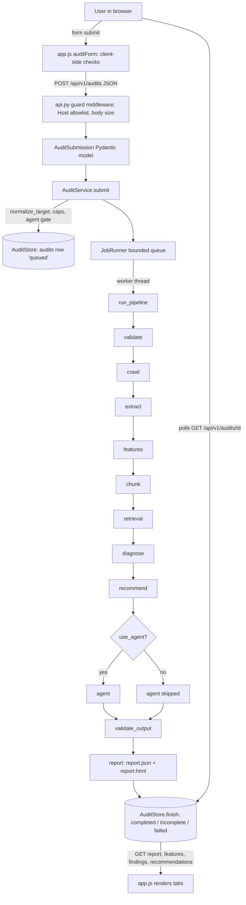
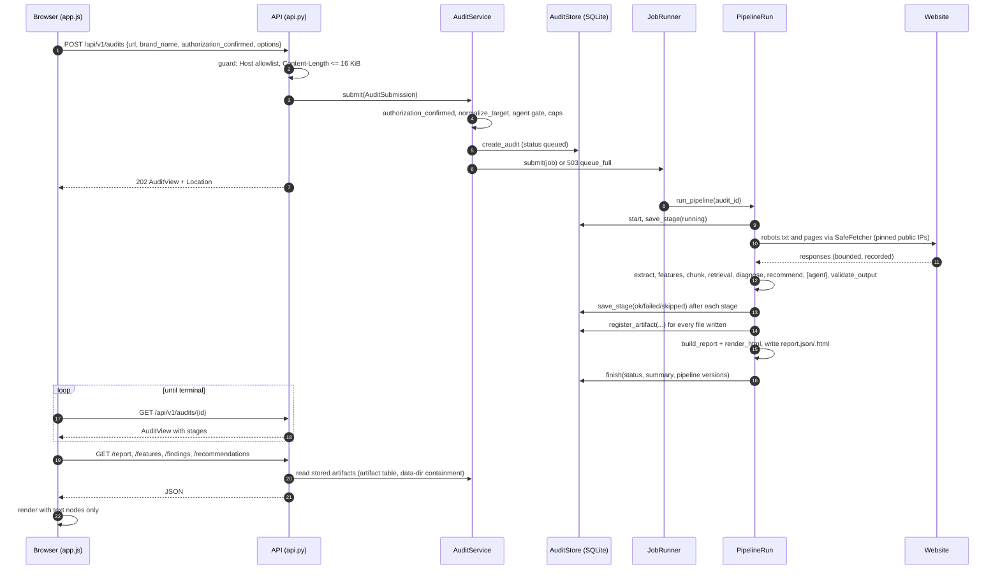

# Execution flow

How one audit runs, from the moment a user presses **Start audit** to the moment the
browser renders the report. Every stage below names the real file and function; the order
is the order in `src/geoptimiser/app/pipeline.py::_run_pipeline`. If this page and the code
disagree, the code is right and this page is a bug.

Related: [ARCHITECTURE.md](ARCHITECTURE.md) (what the components are),
[DEVELOPMENT_GUIDE.md](DEVELOPMENT_GUIDE.md) (how to run them),
[FEATURE_VALIDATION_GUIDE.md](FEATURE_VALIDATION_GUIDE.md) (how a feature result is judged).

## 1. Overview



A failure in a **critical** stage (`validate`, `crawl`, `extract`, `features`, `diagnose`,
`recommend`, `validate_output`, `report`; `CRITICAL_STAGES` in `app/models.py`) stops the
remaining stages and ends the audit `failed`. A failure in an optional stage (`chunk`,
`retrieval`, `agent`) lets the run continue and ends it `incomplete`. In both cases a report
describing exactly what happened is attempted.

## 2. Sequence



## 3. Stage-by-stage table

| # | Stage | Entry point (file :: function) | Input | Output | Next | Failure behaviour | Mode | Tests |
|---|---|---|---|---|---|---|---|---|
| 0 | Frontend validation | `app/ui/app.js :: auditForm` submit handler | form fields | JSON body | API | shows the problem, sends nothing | sync (browser) | `tests/e2e/browser_e2e.py` |
| 1 | API request validation | `app/api.py :: create_app.guard`, `submit` | HTTP request | `AuditSubmission` | service | 400 `invalid_host`, 413 `body_too_large`, 422 `invalid_request` (field names only, never values) | sync | `tests/app/test_api.py` |
| 2 | Backend validation | `app/service.py :: AuditService.submit`, `app/models.py :: normalize_target` | submission | `AuditRecord` (queued) | JobRunner | 422 `authorization_required`, `invalid_target`, `agent_disabled`, `options_out_of_range`; 503 `queue_full` | sync | `tests/app/test_models_jobs.py`, `tests/app/test_security.py` |
| 3 | Audit initialization | `app/jobs.py :: JobRunner.submit`, `app/pipeline.py :: _run_pipeline` | audit id | `PipelineRun` | validate | unexpected exception → `failed` / `internal_error` | async (worker thread) | `tests/app/test_pipeline.py` |
| 4 | validate | `PipelineRun.validate` | record options | effective `max_pages`/`max_depth` (server caps applied) | crawl | — | async | `tests/app/test_pipeline.py` |
| 5 | URL discovery + fetching + response storage (crawl) | `PipelineRun.crawl` → `crawler/crawl.py :: Crawler.run` → `crawler/fetcher.py :: SafeFetcher.fetch`; bodies in `crawler/storage.py :: LocalBodyStore` | seed URL, `CrawlConfig` | `fetches.jsonl`, `skipped_urls.jsonl`, `crawl_summary.json`, `bodies/` | extract | no successful page → `classify_seed_failure` (dns, tls, timeout, blocked_target, http_error, robots, no_content) → audit `failed` | async | `tests/crawler/*`, `tests/app/test_e2e_validation.py` |
| 6 | Extraction | `PipelineRun.extract` → `extraction/pipeline.py :: extract_all` → `extraction/parser.py :: parse_html` | fetch records + bodies | `extraction/documents.jsonl` (`PageDocument`), failures | features | per-page `ExtractionFailure`; no document at all → `no_content` → `failed` | async | `tests/extraction/*` |
| 7 | Feature evaluation + scoring | `PipelineRun.features` → `features/audit.py :: run_audit` → `features/engine.py :: run_all` → `features/scoring.py :: score_audit` | `load_inputs(crawl dir)` | `features/feature_results.jsonl`, `evidence.jsonl`, `findings.jsonl`, `features.json` | chunk | a check that raises becomes an `error` result for that unit; provenance violation fails the stage | async | `tests/features/*`, `tests/validation/*` |
| 8 | Chunking | `PipelineRun.chunk` → `chunking :: chunk_documents` | documents | `chunks.jsonl` | retrieval | stage failure → `incomplete` | async, optional | `tests/chunking/*` |
| 9 | Retrieval | `PipelineRun.retrieval` → `retrieval :: Retriever` (lexical) or `build_retriever` (semantic) | chunks, requested mode | in-memory retriever + retrieval info | diagnose | `off` → skipped; semantic unavailable → `retrieval_unavailable`, never replaced by lexical | async, optional | `tests/retrieval/*` |
| 10 | Diagnosis | `PipelineRun.diagnose` → `diagnosis/engine.py :: diagnose` | `AuditRun`, chunks, retriever | `findings.json` (`Diagnosis`) | recommend | stage failure → `failed` | async | `tests/diagnosis/*` |
| 11 | Recommendation generation | `PipelineRun.recommend` → `recommendations/generator.py :: TemplateGenerator.generate` | diagnosis | `recommendations.json` (`RecommendationSet`, accepted + rejected) | agent | stage failure → `failed` | async | `tests/recommendations/*` |
| 12 | Optional agent | `PipelineRun.agent` → `agent/graph.py :: run_agent` | `AgentContext`, `AgentConfig` | `agent_trace.json` | validate_output | disabled / unavailable / failed / incomplete → stage failed → audit `incomplete`; not requested → skipped | async, optional | `tests/agent/*` |
| 13 | Output validation | `PipelineRun.validate_output` → `diagnosis :: validate_diagnosis`, `recommendations :: validate_recommendations` | diagnosis, recommendations, run, chunks | problem list | report | any problem → `validation_failed` → `failed`; findings and recommendations are then withheld from the report | async | `tests/diagnosis/*`, `tests/recommendations/*` |
| 14 | Scoring / reportability | computed in stage 7 (`score_audit`); exposed by `app/report.py :: build_report` | scores | `reported_score`, `status`, `withheld_reason` per group | report | below `min_reportable_coverage` → score withheld | async | `tests/app/test_reportability.py`, `tests/features/test_scoring_policy.py` |
| 15 | Report persistence | `PipelineRun.write_report` → `build_report`, `render_html` | pipeline state | `report.json`, `report.html` (rendered first; nothing written on failure) | finish | failure → audit `failed` with `internal_error` | async | `tests/app/test_pipeline.py` |
| 16 | Finish | `AuditStore.finish` | status, summary, versions | terminal audit row | — | if even this fails, the next start marks the audit `interrupted` (`recover_interrupted`) | async | `tests/app/test_store_restart.py` |
| 17 | API response | `GET /api/v1/audits/{id}`, `/report`, `/features`, `/findings`, `/recommendations`, `/report.html` | stored artifacts via `AuditService._read` | JSON / HTML | browser | 400 bad id, 404 unknown, 409 not available for this audit | sync | `tests/app/test_api.py` |
| 18 | Frontend rendering | `app/ui/app.js :: route`, `renderAudit`, tab renderers | API JSON | DOM (text nodes only) | — | API errors shown in place; 409 shown as "not available" | sync (browser) | `tests/e2e/browser_e2e.py`, `tests/app/test_static_export.py` |

## 4. Data flow

Raw observations and derived data are separate files under
`<data-dir>/audits/<audit_id>/`, each registered in SQLite with size and SHA-256
(`AuditStore.register_artifact`):

```text
fetches.jsonl + bodies/  ──►  extraction/documents.jsonl  ──►  features/*.jsonl, features.json
                                        │                                   │
                                        └──► chunks.jsonl ──► (retriever, in memory)
                                                                            │
                                    findings.json (diagnosis) ◄─────────────┘
                                           │
                                    recommendations.json ──► [agent_trace.json]
                                           │
                              report.json + report.html (only from the above)
```

The API never recomputes anything: `/report`, `/findings` and `/recommendations` read
`report.json`; `/features` joins `features/feature_results.jsonl` with the report's
per-feature score entries (`AuditService.features`).

## 5. Branches

**Success.** All stages `ok` (agent `skipped` when not requested) → `completed`.

**No-agent path (default).** `options.use_agent` is false → `run.skip("agent", …)` →
the stage record is `skipped` with the reason; the report's `agent` is
`{"requested": false, "status": "not_requested"}`. Nothing else changes: findings,
scores and recommendations never depend on the agent.

**Agent enabled.** `run_agent` runs a bounded LangGraph loop (inspect → decide ↔ act →
finalize) over six allowlisted read/validate tools (`agent/tools.py`). It writes only
`agent_trace.json`. Its status is recomputed from deterministic checks
(`AgentRuntime.finalize`), not taken from the model.

**Agent unavailable.** Server started with `--no-agent` → the submission is refused with
`agent_disabled` before anything runs. Key or extra missing at run time → `ModelError`
→ stage `failed` (`agent_unavailable`) → audit `incomplete`.

**Retrieval disabled.** `retrieval: "off"` → stage `skipped`; diagnosis still runs and
attaches only the feature evidence (no located passages).

**Retrieval enabled.** `lexical` → BM25 over this audit's chunks. `semantic` → hybrid
(BM25 + embeddings, reciprocal rank fusion). If embeddings cannot be built the stage fails
with `retrieval_unavailable` and the audit is `incomplete` — lexical retrieval is never
silently substituted.

**Partial crawl / incomplete audit.** If the crawl stops on `audit_timeout`,
`audit_byte_budget` or `aborted`, the audit ends `incomplete` even when every stage
succeeded (`PipelineRun.outcome`). Truncated bodies and extraction limits make the checks
that need the missing part `not_measured` (`features/evidence.py`), never `fail`.

**Score withholding.** For every group (overall, pillar, category) the score is shown only
when `feature_coverage >= min_reportable_coverage` (0.5 by default). Otherwise
`reported_score` is null and `withheld_reason` says why. The UI (`shownScore` in
`app.js`) and the HTML report (`shown_score` in `report.py`) only ever display
`reported_score`.

**Failed crawl.** No successful page → `classify_seed_failure` gives a safe category and
message → audit `failed` → no feature results exist and `/features` answers 409.

**Report generation.** `write_report` renders the HTML first; if rendering or writing
fails, both files are removed, so a report that claims success can never exist for an
audit that failed there.

## 6. What runs where

| Concern | Where it runs | Notes |
|---|---|---|
| Form checks | browser | convenience only; the server re-validates everything |
| HTTP handling | uvicorn event loop | handlers are synchronous and short |
| Audit work | `JobRunner` worker thread(s) (`workers` 1–4) | bounded FIFO queue (`max_queued`) |
| Network egress | `SafeFetcher` inside the worker | resolve once, pin, re-check peer, verified TLS |
| Persistence | SQLite (WAL) + files in the data dir | one process per data dir |
