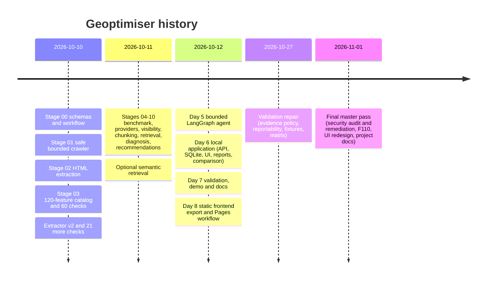

# Project decisions and history

How Geoptimiser got to its current state, and why it is built the way it is. The decision
records themselves are in [../DECISIONS.md](../DECISIONS.md) (ADR-0001 to ADR-0034); this
page is the short version, in order, with what each decision means for someone working on
the code today.

Related: [ARCHITECTURE.md](ARCHITECTURE.md), [EXECUTION_FLOW.md](EXECUTION_FLOW.md),
[DEVELOPMENT_GUIDE.md](DEVELOPMENT_GUIDE.md),
[FEATURE_VALIDATION_GUIDE.md](FEATURE_VALIDATION_GUIDE.md),
[SECURITY_REVIEW.md](SECURITY_REVIEW.md).

## 1. What the project is for

Geoptimiser audits a website the user is authorised to audit and reports how well it can
be read, understood and cited by answer engines (generative engine optimisation, GEO). The
founding rules, which still decide most trade-offs, are in `CLAUDE.md`:

* every finding links to evidence, a measurement method, its limits and a way to verify it;
* a missing measurement is never reported as a negative result;
* correlation is never presented as causation, and no outcome is promised;
* deterministic code measures; models are added only where they measurably help;
* crawled content is data, never instructions.

## 2. Timeline

Dates are commit dates from the repository history.

| Period | Work | Main commits / PRs |
|---|---|---|
| 2026-10-10 | Repository moved to the root; Stage 00 strict shared schemas (ADR-0004), fetch/extraction split (ADR-0005), versioning (ADR-0006) | `af2bf2d`, `1e882b2`, `8dabf41`, PR #1 |
| 2026-10-10 | Stage 01 crawler with SSRF defences, robots, byte and time budgets; remediation of incomplete responses and TLS | `91b5df8`, `6167f62`, PR #2 |
| 2026-10-10 | Stage 02 extraction (stdlib parser); Stage 03 catalog of 120 features with 60 checks; extractor v2 with 21 more | `e50aa22`, `b705d72`, `e1c0740`, PRs #3–#5 |
| 2026-10-11 | Stages 04–10: query benchmark, provider contract, visibility metrics, chunking, retrieval baselines, diagnosis, template recommendations; semantic extra | `1f8288c` … `762c5c6`, `7773257`, PR #6 |
| 2026-10-12 | Day 5 agent (LangGraph, OpenRouter, fake-model tests) | `4a8086b`, PR #7 |
| 2026-10-12 | Day 6 application layer: FastAPI, SQLite store, job runner, UI, HTML report, comparisons | `16d120e`, PR #8 |
| 2026-10-12 | Day 7 end-to-end validation, defect fixes, offline demo, docs | `6738256`, `9236210`, PR #9 |
| 2026-10-12/13 | Day 8 static UI export, configurable API base, opt-in CORS, GitHub Pages workflow | `45aa6b5`, `3dae13d`, `73005ea`, PRs #10–#11 (`220e9c7` on `main`) |
| 2026-10-27 | Validation repair on `claude/geoptimiser-validation-repair-ncsv4p`: extraction v3, evidence policy, owner-policy notices, reportability, fixture harness, matrix | `3e3e6b5`, `3da222d`, `31805c2`, `fce9c1d` |
| 2026-11-01 | Final master pass (this work, uncommitted on `claude/geoptimiser-final-master`): security audit run 1 and fixes, F110, F001 v2, F070 v2, three-level classification, app-pipeline validation, redesigned UI, browser tests, project docs | ADR-0031 to ADR-0034 |

## 3. Decisions by theme

### Foundations (ADR-0001 to ADR-0006)

* **A modular Python pipeline first** (0001): each stage runs and tests on its own; the API
  and UI came last. *Today:* every stage still has its own CLI (`python -m
  geoptimiser.crawler`, `.extraction`, `.features`, …).
* **Evidence-linked findings** (0002) and **model complexity must earn its place** (0003):
  the reason recommendations are templates, not model output, and the agent is optional.
* **Strict schemas with provenance** (0004–0006): Pydantic models reject unknown fields and
  carry schema versions, audit ids and timestamps. Fetch records and extracted documents
  are separate artifacts, so extraction can be re-run on stored bodies.

### Crawling and extraction (ADR-0007 to ADR-0010, 0013)

* **Content-addressed body store** (0007): bodies stored once by hash, per audit. Retention
  is not enforced (still true).
* **Hard limits** (0008): 2 MB per response, 50 MB per audit, page, depth and time budgets;
  truncation is recorded, never hidden.
* **Network safety** (0009): stdlib `http.client`, resolve once and pin the address,
  re-check the connected peer, follow redirects by hand and check every hop.
* **Stdlib HTML parser** (0010, 0013): no lxml or browser; one parse produces the full
  `PageDocument` (headings, links, JSON-LD, images, landmarks, tables). *Consequence:*
  JavaScript is not rendered (F108 is unavailable), and the report says so.

### Features, findings and scores (ADR-0011, 0012, 0027–0029)

* **A 120-feature catalog with an honest registry** (0011): the catalog in
  `features/catalog_data.py` is the product vocabulary; a feature without a check is
  labelled planned, never silently skipped.
* **Missing data is not rewarded or punished** (0012, 0027): incomplete evidence (a
  truncated body, an unreadable robots file) gives `not_measured`, per check.
* **Owner choices are notices** (0028): noindex or blocking a crawler is reported, not
  graded as a defect.
* **Contribution and reportability** (0029): checks that cannot discriminate, or that
  repeat another check, count once or not at all; a score is shown only when at least half
  of its features were measured (`reported_score`, `withheld_reason`).

### Retrieval, diagnosis, recommendations, agent (ADR-0014 to ADR-0023)

* Query benchmark, provider contract and visibility metrics exist, with mock and fixture
  providers only: **no live answer-engine adapter**, so no observed AI outcome (0015–0017).
* Chunking keeps exact offsets so every chunk is a verbatim slice (0018); retrieval has BM25,
  a dense baseline, RRF and an optional local semantic model (0019, 0022).
* Diagnosis extends feature findings with located passages (0020); recommendations come
  from templates, with an unsupported-claim screen and an ungrounded-URL check (0021).
* The agent is one bounded LangGraph loop over six allow-listed tools with a deterministic
  final status; its output never changes the report (0023).

### Application and deployment (ADR-0024 to ADR-0026)

* **Local-first** (0024): FastAPI on loopback, SQLite, a small job runner, **no
  authentication**. This is still the main structural risk (see the security review).
* **Validated through real interfaces** (0025), with a reproducible offline demo.
* **Static UI on GitHub Pages, backend local** (0026): prepared, not verified live.

### Validation (ADR-0030, 0031)

* **A repeatable harness** (0030): synthetic fixtures with expectations written before the
  code runs; a generated, test-checked feature matrix; a labelled corpus that is honest
  about being repository-local.
* **Three classifications and a pipeline level** (0031): implementation level, highest
  validation level and disposition for every feature, generated and served by the API.

### Final master pass (ADR-0032 to ADR-0034)

* **Catalog version 3** (0032): F110 (HTTPS and HSTS) implemented from RFC 6797; F001 treats
  429 and 503 with Retry-After as not measured; F070 is bounded.
* **Redesigned UI** (0033): vanilla JavaScript, self-hosted fonts, a measurement ledger, a
  feature explorer, text-node-only rendering.
* **Security remediation** (0034): fixes for every confirmed finding of the security audit,
  plus hardening; open risks listed in [SECURITY_REVIEW.md](SECURITY_REVIEW.md).

## 4. Things that were tried or considered and not done

| Idea | Why not (yet) | Where recorded |
|---|---|---|
| Headless browser rendering | heavy dependency and a new attack surface; F108 stays unavailable | ADR-0010, feature audit §9 |
| A live answer-engine adapter | needs provider terms, keys and a measurement protocol; category L stays unimplemented | ADR-0016, `docs/validation/AI_OUTCOME_PROTOCOL.md` |
| Model-written recommendations | could not be checked for faithfulness as cheaply as templates | ADR-0021 |
| Lowering the 0.5 coverage threshold to show more scores | arbitrary; would show scores the evidence cannot support | ADR-0029 |
| Deleting redundant features | loses diagnostic detail; they now count once | ADR-0029 |
| Authentication | product decision; the API stays loopback-only by default | ADR-0024, ADR-0034 |
| A frontend framework | toolchain and supply chain for a local tool | ADR-0033 |

## 5. Current state in numbers (2026-11-01)

| | Value |
|---|---|
| Features | 120: 41 implemented, 41 partial, 36 planned, 2 unavailable |
| Validation level | 38 not tested, 47 unit-tested only, 35 pipeline-validated, 0 real-page, 0 outcome |
| Disposition | 24 retain, 15 revise, 32 informational only, 49 investigate, 0 remove |
| Fixtures | 27 synthetic fixtures, 291 pre-declared expectations, all met |
| Tests (`.[dev,api,agent,web]`) | 1701 passed, 4 skipped (live OpenRouter tests and the uninstalled semantic extra) |
| Real-world benchmark | none; precision targets not assessed |

The numbers above are produced by the commands in
[DEVELOPMENT_GUIDE.md §4](DEVELOPMENT_GUIDE.md#4-quality-gates); rerun them rather than
trusting this table after further changes.
